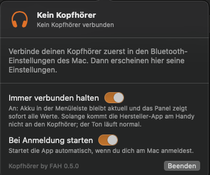
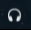

# Kopfhörer by FAH

Mac-Menüleisten-App für Kopfhörer, deren Einstellungen macOS nicht kennt. Sie erkennt den Kopfhörer, der gerade
per Bluetooth am Mac hängt, und bietet genau seine Einstellungen an: Hörmodi (Noise Cancelling, Ambient Aware,
TalkThru), Equalizer, Spatial Sound, Voice Aware, Tastenbelegung, Auto-Aus und alles Weitere, was die Hersteller-App
am Handy kann. Firmware-Updates gehören nicht dazu; die bleiben bei der Hersteller-App.

Inoffiziell. Nicht von JBL/Harman/Bose/Huawei/Sony/Samsung/Anker. Markennamen nur zur Angabe, mit welchen Geräten die App funktioniert.

## So sieht es aus

 &nbsp; 

Panel und Symbol in der Menüleiste (hier ohne verbundenen Kopfhörer).

## Unterstützt

| Familie | Modelle | Stand |
|---|---|---|
| JBL „bes“ | 40 Modelle, u. a. Live 670/675/770/775NC, Tune Beam/Buds, Tour Pro 2 | am Live 775NC geprüft |
| JBL „Protocol4“ | 35 Modelle, u. a. Tune 680/780/785NC, Live 680/780NC | aus JBLProtocol4 (MIT), dort am Tune 780NC geprüft |
| JBL „protocol3“ | 8 Modelle (Wave/Vibe/Tune Buds/Flex/Beam 2, Tune 255NC) | nach JBL-App-Code, **ungeprüft** (Hinweis im Panel) |
| JBL Airoha („airoha“, „lea“) | 13 Modelle (u. a. Tune 775NC/777NC, Live Free 2, Tune 670/770NC) | nach JBL-App-Code, **ungeprüft**; nur Grundfunktionen, kein EQ/Gesten |
| Bose BMAP | 21 Kopfhörer/Ohrhörer (QuietComfort, QC Ultra, QC35 …); Einstellungen erfragt die App beim Gerät | am QuietComfort Headphones geprüft |
| Huawei SPP | FreeClip, FreeBuds …; Einstellungen erfragt die App beim Gerät | am FreeClip geprüft |
| Sony MDR (V1/V2) | WH-1000XM2–XM6, WF-1000XM3–XM5, WF-C/SP, WI-…, LinkBuds, ULT WEAR; Hörmodus + Umgebungsstärke, EQ, Auto-Pause, Ausschalten | nach Gadgetbridge/MDR-Projekten, **ungeprüft** |
| Samsung Galaxy Buds | Buds+, Live, Pro, Buds2 … Buds4 Pro (nicht Buds 2019); Hörmodus, EQ-Voreinstellungen, Akku | nach GalaxyBudsClient, **ungeprüft** |
| Anker Soundcore | ~40 Kopfhörer; Akku bei allen, Hörmodus nur bei der Grundform (Life Q30/Q35, Life Tune, Life P3 …) | nach OpenSCQ30, **ungeprüft** |

Der Modellkatalog (`Sources/Kopfhoerer/Katalog/KatalogDaten.swift`) entsteht mit `tools/katalog_erzeugen.py` aus den
Assets der JBL-Headphones-App. Jedes Modell bekommt nur die Einstellungen, die die JBL-App für es zeigt.

## Bauen und installieren

    ./build.sh            # bauen + signieren → build/Kopfhörer by FAH.app
    ./build.sh --install  # nach /Applications und starten
    ./build.sh --test     # Tests

Signiert wird mit dem Apple-Development-Zertifikat, damit macOS die Bluetooth-Freigabe über Builds hinweg behält.
`FAHKopfhoerer --vorschau bild.png [hell|dunkel] [sony]` zeichnet das Panel mit Beispielwerten als Bild.

## Aufbau

- `Sources/Kopfhoerer/` – Bibliothek ohne Oberfläche: Katalog, Bluetooth (`Steuerung`, `AudioGeraete`, Kanäle),
  Treiber je Protokollfamilie (`Treiber/JBLBes`, `Treiber/JBLProtocol4`, `Treiber/BoseBMAP`, `Treiber/Huawei`,
  `Treiber/Sony`, `Treiber/Samsung`, `Treiber/Soundcore` …). Ein Treiber kennt nur Bytes und baut aus
  den Gerätemeldungen die Zeilen des Panels (`Regelung`).
- `Sources/FAHKopfhoerer/` – Menüleiste und Panel.
- `docs/protokoll-bes.md` – Protokoll der bes-Familie mit Fundstellen; `docs/protokoll-bose.md` – Bose BMAP;
  `docs/protokoll-huawei.md` – Huawei SPP; `docs/protokoll-{sony,samsung,soundcore}.md` – weitere Marken; `docs/protokoll-jbl-{protocol3,airoha,lea}.md` – weitere JBL-Familien;
  `docs/plan.md` – Stufenplan.
- Übertragung: `Verbindung/BLEKanal` (JBL), `Verbindung/RFCOMMKanal` (alle anderen; Dienst per SDP-Verzeichnis);
  `Steuerung` wählt den Kopfhörer, über den gerade der Ton läuft, und den passenden Kanal. Sony, Samsung und Soundcore
  erkennt `AudioGeraete` an ihren Steuerdiensten im SDP-Verzeichnis (`Katalog/MarkenKatalog.swift`).
- `FAHKopfhoerer --pruefen ["Name"]` verbindet sich ohne Fenster, liest alles und gibt es als Text aus
  (`FAH_PROTOKOLL=1` zeigt die Rohdaten).

## Sicherheit

Jeder Treiber sendet nur Befehle aus einer festen Liste; Firmware, DFU, Sprachpakete und unbekannte Befehle werden
verweigert. Werte im Panel stammen immer aus der Rückmeldung des Geräts. Der Kopfhörer nimmt nur eine
Steuerverbindung an: Solange die App sie hält, kommt die Handy-App nicht dran (Ton ist nicht betroffen).

## Lizenzen

Der Protocol4-Teil stammt aus [JBLProtocol4](https://github.com/NeoHBz/JBLProtocol4) (MIT, © 2026 NeoHBz),
siehe `docs/LICENSE-JBLProtocol4.txt`. Das Bose-Protokollwissen stützt sich auf
[bosectl](https://github.com/alabalag1/bosectl) (MIT); übernommen sind Fakten (Befehle, Produktkennungen), kein Code.
Das Huawei-Protokollwissen stammt aus [OpenFreebuds](https://github.com/melianmiko/OpenFreebuds) (GPL-3.0); auch
dort sind nur Fakten übernommen, kein Code. Für Sony, Samsung und Soundcore gilt dasselbe: Fakten aus Gadgetbridge
(AGPL), SonyHeadphonesClient/MDR-Projekten (MIT), GalaxyBudsClient (GPL-3.0) und OpenSCQ30 (GPL-3.0), kein Code;
Fundstellen stehen in den jeweiligen `docs/protokoll-*.md`.
